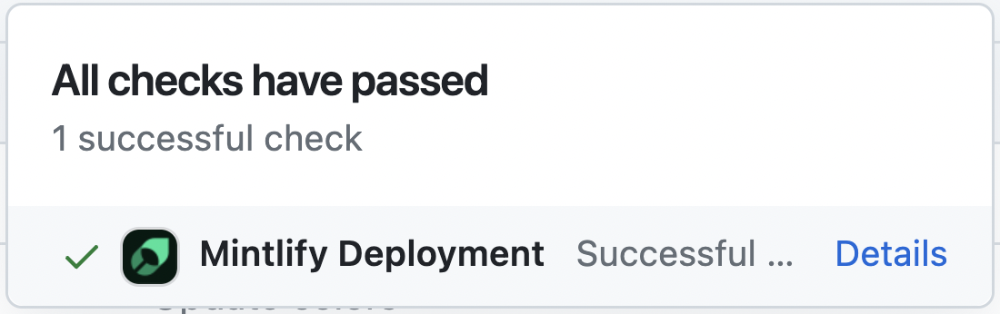

<Info>
  **Prérequis** :
  - Node.js version 19 ou supérieure
  - Un dépôt de documentation contenant un fichier `docs.json`
</Info>

Suivez ces étapes pour installer et exécuter Mintlify sur votre système d'exploitation.

<Steps>
<Step title="Installer la CLI Mintlify">

```bash
npm i -g mint
```
</Step>

<Step title="Prévisualiser en local">

Accédez au répertoire de votre documentation où se trouve votre fichier `docs.json`, puis exécutez la commande suivante :

```bash
mint dev
```

Une prévisualisation locale de votre documentation sera disponible à l'adresse `http://localhost:3000`.

</Step>
</Steps>

## Ports personnalisés

Par défaut, Mintlify utilise le port 3000. Vous pouvez personnaliser le port sur lequel Mintlify s'exécute en utilisant l'option `--port`. Par exemple, pour exécuter Mintlify sur le port 3333, utilisez cette commande :

```bash
mint dev --port 3333
```

Si vous essayez d'exécuter Mintlify sur un port déjà utilisé, il utilisera le prochain port disponible :

```md
Port 3000 is already in use. Trying 3001 instead.
```

## Versions de Mintlify

Veuillez noter que chaque version de la CLI est associée à une version spécifique de Mintlify. Si votre prévisualisation locale ne correspond pas à la version de production, mettez à jour la CLI :

```bash
npm mint update
```

## Validation des liens

La CLI peut vous aider à valider les liens de votre documentation. Pour identifier les liens cassés, utilisez la commande suivante :

```bash
mint broken-links
```

## Déploiement

Si le déploiement réussit, vous devriez voir ce qui suit :

<Frame>
  
</Frame>

## Formatage du code

Nous vous suggérons d'utiliser des extensions sur votre IDE pour reconnaître et formater le MDX. Si vous utilisez VSCode, envisagez l'[extension MDX pour VSCode](https://marketplace.visualstudio.com/items?itemName=unifiedjs.vscode-mdx) pour la coloration syntaxique, et [Prettier](https://marketplace.visualstudio.com/items?itemName=esbenp.prettier-vscode) pour le formatage du code.

## Dépannage

<AccordionGroup>
  <Accordion title='Erreur : Could not load the "sharp" module using the darwin-arm64 runtime'>

    Cela peut être dû à une version obsolète de Node. Essayez ce qui suit :
    1. Supprimez la version actuellement installée de la CLI : `npm remove -g mint`
    2. Effectuez une mise à niveau vers Node v19 ou supérieure.
    3. Réinstallez la CLI : `npm i -g mint`
  </Accordion>

  <Accordion title="Problème : Erreur inconnue rencontrée">
  
    Solution : Allez à la racine de votre appareil et supprimez le dossier `~/.mintlify`. Puis relancez `mint dev`.
  </Accordion>
</AccordionGroup>

Curieux de savoir ce qui a changé dans la dernière version de la CLI ? Consultez le [changelog de la CLI](https://www.npmjs.com/package/mintlify?activeTab=versions).
